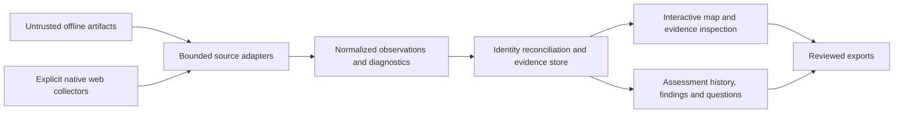

# Architecture principles and evidence model

**Status:** product-direction baseline and logical model, October 12, 2026. Version 0.4.0 implements a bounded subset in Python, local SQLite and a browser UI; [ADR 0002](adr/0002-local-initial-product.md) records actual choices, formats, storage and remaining limits. Some richer logical entities/lifecycle contracts below remain future design requirements. [ADR 0001](adr/0001-evidence-first-imports.md) records the established direction.

## Evidence flow and trust boundaries

Source-specific adapters normalize data into one common model. Store observations before deciding their canonical identity or projecting graph edges. The graph is a view of evidence, not the sole source of truth. Raw artifacts stay in controlled storage under the [security policy](../SECURITY.md). Import, display, and export are separate trust boundaries. A future collector boundary is independently authorized; offline import must not cross it.

## Proposed common entities

| Entity | Meaning and key constraints |
| --- | --- |
| Engagement/workspace | Scope, authorization reference, exclusions, operator, retention policy, and network/address namespaces; isolate engagements |
| Device candidate | Opaque internal identity with attributed names, identifiers, fingerprint/role claims, and reconciliation state; an IP or hostname is not its primary identity |
| Interface | Device-scoped identifier and attributed properties; names and indices can change across versions and time |
| Address/subnet | IPv4/IPv6, assignment observations, subnet/VRF/site context, and validity interval if known; overlapping ranges can exist |
| Service/application resource | Address/interface context, transport and port, state, product/signature claims; web origin and path are distinct resources |
| Evidence artifact | Protected raw reference, digest, format, source/tool/version, import batch, sensitivity, and retention/deletion state |
| Observation | A sourced claim about an entity or relationship with the evidence envelope below |
| Typed relationship | Endpoints, direction, type, temporal/context qualifiers, and supporting observation IDs; do not collapse into an unlabeled edge |
| Reconciliation decision | Actor/time, candidate identities, rationale, supporting/counter evidence, and reversible merge/split history |
| Assessment records | Later findings, access achieved, questions, tests and retests linked to affected entities and evidence |

This list is a contract for design work, not a final wire schema. Exact IDs, schema version rules, storage, tenancy, and APIs need implementation ADRs.

## Observation envelope and meaning

Every observation must retain its engagement, source artifact and precise location (such as XML element or output section), source tool/device and version where known, adapter/version, collection time, import time, testing vantage, relevant namespace, and raw evidence reference. Preserve the original value alongside normalization. Missing collection time or vantage is explicitly `unknown`, with reason; import time is not a substitute.

Keep these dimensions separate:

- **Claim status:** observed, inferred, or unknown. An inferred claim links its premises and rule/manual reasoning. Unknown is a represented gap, not negative proof.
- **Evidence basis:** configured, operational, active test, passive observation, or manual assertion. A configuration can be observed as text while its assertion of current connectivity remains untested.
- **Source confidence and validity:** retain a source's score/label and its meaning without turning unlike scores into a universal percentage. Record time interval, staleness, contradictions, and parser warnings.

Do not overwrite a prior observation when newer evidence disagrees. Derived views may prefer a selected snapshot, but must expose selection rationale and conflicting/history records. Absence from a scan, `filtered`, `open|filtered`, a failed login, or a missing neighbor response is not equivalent to nonexistence or universal inaccessibility. Support claims remain bounded by the actual source and vantage.

## Relationship semantics

| Relationship | Evidence needed and limits |
| --- | --- |
| Address assignment / subnet membership | Attributed device/interface/address data; computed CIDR membership is an inference, not VLAN or physical adjacency |
| Name resolution | DNS record type, name/address or alias, resolver/vantage, time and TTL where available; does not establish device identity |
| Local neighbor | ARP/NDP or neighbor-protocol output with local interface and time; ARP alone does not identify an exact switch port |
| Observed routed path | Ordered traceroute hops, missing hops, probe context and source; describes that observation, not all traffic or a physical link |
| Configured route | Configuration/route data with destination, next hop, interface and VRF; configuration intent is distinct from forwarding observations |
| Physical adjacency | Attributed interface/neighbor evidence or explicit manual verified evidence; protocol-reported adjacency must disclose its basis and uncertainty |
| VLAN membership | Interface VLAN configuration or operational output, platform/site context, tag/access/trunk meaning and time; an IP subnet is not proof |
| Tested reachability | Source/vantage, target, protocol/port, method, result and time; one successful test does not prove another host pair's connectivity |
| Service or application association | Sourced service state or web origin/path response; a port lookup, banner or path is not a validated vulnerability |
| Access achieved | Separate authenticated/authorized access evidence, role, target and time; no credentials stored, and access alone adds no topology |

Nmap-only imports must still display hosts/services and attributed fingerprint hypotheses. If no topology evidence exists, group them visually without fabricating links. Preserve service detection method and port state rather than promote all labels to verified products. Nmap XML and topology semantics are described in the [research references](existing-tools.md).

## Identity and temporal reconciliation

Never merge solely because names or IPs match. Compare candidate identifiers with engagement, network namespace, address reuse over time, interface relationships, device-specific evidence, and conflicts. Strong identifiers can also be duplicated or cloned. Present ambiguous candidates for review; allow a user to keep identities separate or record a supported merge. An inferred suggestion is not an accepted merge.

Merge/split decisions must be reversible and retain source observations and prior associations. Re-importing an identical artifact must have documented repeat behavior without silently duplicating facts; a changed artifact creates new observations. Re-running a newer parser must preserve its version and derivation history. Failed imports must not silently alter existing identities. Transaction and partial-import mechanics remain proposals for a spike.

## Adapter and view obligations

Adapters declare supported formats/versions, input limits, exact mappings, diagnostics and unsupported fields. Preserve unknown fields through raw references rather than invent meanings. Keep parsing independent of live access. [Contributing](../CONTRIBUTING.md) defines support evidence and maintenance obligations.

Map inspection must expose relation type, observed/inferred/unknown status, evidence basis, time, vantage, supporting and conflicting observations. Filters/snapshots must make omitted and stale evidence understandable. Findings, tests and access history should refer to the same entities; retain separate evidence levels for service exposure, authentication, authorization and impact.

Exports must preserve typed edges and provenance references plus time/vantage, uncertainty, conflict and redaction information. They must not turn inferred graph routes into demonstrated attack paths. Export formats, graph library and durable storage remain undecided. [Roadmap gates](roadmap.md) define the first end-to-end evidence required.

## Native web implementation

[ADR 0003](adr/0003-native-web-workbench.md) records actual native tool boundaries, logical web origin/resource/parameter entities, atlas-web/1 normalization, source/body digests, offline/native intake provenance, schema-2 exact backup and persisted run states. A proxy is an explicitly configured local tool, not an endpoint agent. Public CA input does not disable TLS; the isolated browser trusts only its ephemeral proxy CA pin while the proxy verifies upstream. The broader logical model above remains a destination, not a parity claim.

## Native vulnerability and operator extension

[ADR 0006](adr/0006-public-advisory-scans.md) adds a bounded public cache (schema 1), inventory-to-advisory jobs and direct inferred observations/findings on existing assets. Source snapshots and inventory references are copied into the assessment before cache replacement; main schema remains 2. Nmap adapter 3 retains CPEs. Public queries exclude target/credential/assessment identity fields. Discovery and a searchable tool directory prepare context without executing imported content or starting a target request. [Vulnerability scans](vulnerability-scans.md) and [operator workflow](operator-workflow.md) define exact contracts.

## Hosted operator console

[ADR 0007](adr/0007-hosted-operator-console.md) adds optional fixed HTTPS operator authentication, browser-session/workspace-bound Linux PTYs and native browser actions. Protected raw operation files are separate from normalized assessment storage and exports. Selected excerpts reference existing identities and native runs where available; manually authored findings now appear in the Findings view. Schema 2 remains unchanged. See [Hosted console](hosted-console.md) for trust, vantage, deployment and qualification limits.
