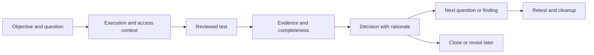

# Atlas: from observations to defensible findings

**Proposed product direction · October 14, 2026**

Atlas should become the place an assessor works through an investigation, from the first observation to a reproducible finding and its retest. Its most useful promise would be: **return to any assessment and know what you believe, why you believe it, and what to test next.**

The initial audience is the solo assessor working through authorized HTB labs and small network or web assessments, using a browser with Ubuntu, Kali or Parrot execution. This audience follows the owner's stated use case; demand beyond it has not been established. The same evidence model should support professional delivery without creating a separate product.

This document proposes priorities. It does not change the accepted architecture, implement capabilities, or authorize target activity. The [existing roadmap](roadmap.md) preserves delivery history and original acceptance gates.

Implementation update: [0.7.0 resumable investigations](investigations.md) implements the first functional slice. Version 0.8.0 implements the next [execution-context slice](execution-context.md), including reviewed new-run continuation. Productivity, operator-trial and later milestone gates remain open; implementation does not establish those outcomes.

## The product decision

Three directions are plausible:

| Direction | Attraction | Main weakness | Decision |
| --- | --- | --- | --- |
| HTB mission companion | A clear starting audience, optional explanations, useful debriefs | Can become a walkthrough or checklist that experienced assessors outgrow | Use an optional learning view over the assessment workflow |
| Autonomous pentest operator | Promises less repetitive work | Reliability, execution context and unsupported conclusions become central problems | Automate bounded, reviewed work in stages; keep interpretation inspectable |
| Evidence-led investigation workspace | Connects questions, execution, evidence, decisions and delivery across sessions | Structure could cost more effort than ordinary notes | Make this the core product and test that tradeoff early |

Contextual handoffs, annotations and reporting already exist in tools such as [Burp](https://portswigger.net/burp/documentation/desktop/tools/context-menu); [Dradis](https://writebook.dradis.com/support/guides/projects/issues.html) already distinguishes issues from their evidence. Atlas must prove its value through easier resumption, clearer decisions and less evidence reconstruction. Those are differentiation hypotheses, not established market advantages.

The strongest counterargument is practical: a good tester already has a terminal, browser and notes. Atlas earns its place only if those activities become easier together. **If its structure slows testing down, simplify capture and retrieval before adding more workflow.**

## The central object: an investigation

An asset answers “what exists?” A finding answers “what went wrong?” An investigation connects the work between them.

An investigation needs a plain-language question, relevant assets, supporting and contradicting evidence, tests already tried, the latest interpretation, and the next action or blocking prerequisite. Decisions can be supported, refuted or inconclusive. A negative result can complete useful work; a finding is not mandatory.

Link investigations to the assessment's objectives. A lightweight objective view should show supported conclusions, questions blocking progress, demonstrated access transitions and the next decision to resolve. The operator should be able to explain how the engagement is progressing without counting findings or opening every investigation. Avoid an invented completion percentage.

Most metadata should come from the action itself: workspace, target, execution host, time, tool configuration and output reference. The assessor adds the question and interpretation when useful. Permit free exploration and bookmarking first, with organization afterward. Do not require a form before every command.

The graph becomes a way to inspect these relationships. It must distinguish an observed network relationship, a suspected opportunity and a demonstrated access transition. A CVE match cannot create a demonstrated attack path.

## Six capabilities worth building toward

### 1. Resume an assessment without reconstructing the session

Opening an assessment presents a working brief: objective, last meaningful decision, selected evidence, next useful test, blocked work and stale context. A “Continue” action restores the relevant investigation and prepared controls. Execution starts after the appropriate review.

The brief should say something like: “A service was discovered; anonymous access was tested; the response did not establish object access; next compare an authenticated request.” It should link every statement to its evidence and show the age of observations.

**Useful moment:** return after several days and continue without rereading a terminal transcript or rebuilding browser state. Durable drafts and explicit missing-session warnings are prerequisites. Saved credentials and old sessions must not silently become current access.

### 2. Turn observations into explainable next tests

Atlas proposes a small set of useful actions for the selected question, rather than a catalog of everything a tool can do. Each suggestion explains:

- What observation triggered it and what uncertainty it addresses.
- Prerequisites, scope, execution context and expected effects.
- What result would support the hypothesis, contradict it or leave it unresolved.
- What decision follows each result.

Start with a few curated recipes: investigate a discovered web service, evaluate a software advisory's applicability, and compare an access boundary. Rule-based suggestions are sufficient initially. A skipped suggestion should stay skipped with its reason, instead of returning as permanent noise.

Coverage is a record of known questions and dispositions: untested, blocked, failed to execute, tested with no issue observed, inconclusive, or supported concern. Avoid a global “assessment complete” percentage when the denominator is unknown.

**Useful moment:** “Why this test?” produces a concrete answer tied to current evidence. An advisory lead suggests the smallest applicability check, without presenting the target as exploitable.

### 3. Keep terminal, browser, VPN and access context together

Each operation should make its vantage visible: where it runs, which route or interface applies, what is in scope, which identity is being used, and whether that context is still valid. The browser on the operator's laptop is not the execution host.

For HTB, make connectivity readiness understandable before launching work. Apply consistent execution-context checks across native web collectors and typed terminal operations. Preserve partial output and a clear failure reason when the VPN, job or session disappears. Resuming a test must recheck its prerequisites.

The current Ubuntu execution path can support the first investigation slice. Later, an optional outbound Kali/Parrot connector can put execution beside the operator's HTB VPN. It needs enrollment and revocation, per-job scope and context binding, bounded outputs, and disconnect/cancellation behavior. It is a separate milestone, not a dependency for all product progress.

**Useful moment:** select a service and open the appropriate prepared operation in the correct terminal or browser context, without copying addresses between unrelated panels. Routine steps can share a reviewed bounded plan; changed scope or access context requires renewed review.

### 4. Make authenticated testing about actual access boundaries

Authenticated scans are a starting point. A deeper web workspace would help answer: “Which role can perform this action on whose object, and what proves it?”

Maintain identities through protected references, plus role, ownership, session freshness and expected access. Compare a legitimate baseline with a controlled variation, then preserve the relevant request, response and observed effect. Status codes and response size are clues, not sufficient proof of authorization failure.

A role/action/object matrix is a useful design reference: OWASP describes authorization testing across features, logical roles and, where relevant, data. Atlas should mark expected policy as confirmed or assumed; a pentester may not have an authoritative policy definition. See the [OWASP authorization testing guidance](https://cheatsheetseries.owasp.org/cheatsheets/Authorization_Testing_Automation_Cheat_Sheet.html).

**Useful moment:** with two authorized test accounts and known object ownership, compare the same action across identities, inspect actual object access, and create a finding with both the legitimate control and the failing boundary. The matrix must also preserve expected denials and inconclusive results.

### 5. Build the finding while the investigation is happening

Offer a single capture action for a selected browser exchange, terminal excerpt or imported observation. The resulting evidence item retains source, collection time, identity, vantage, run configuration, completeness and a protected reference to the original where retained. Let the assessor review redaction and add interpretation. Do not silently retain every keystroke or browser secret.

A finding grows from those items: affected assets, observed behavior, reproduction, impact, remediation and proof gaps. Keep advisory correlations, scanner indicators and demonstrated failures distinguishable throughout triage and reporting. Severity and impact remain reviewable judgments.

Retest the assertion with comparable context. Show the original observation beside the new result and explain material differences in role, route, target version or test configuration. Outcomes include reproducible, no longer reproduced, blocked and inconclusive. A changed result alone does not prove remediation.

Track assessment-created accounts, files and configuration changes when applicable, with an owner and cleanup evidence. Report generation should assemble a source-linked narrative the assessor can inspect and edit.

**Useful moment:** a second assessor can understand and reproduce the finding from its retained evidence without asking the original tester to reconstruct the session.

### 6. Make successful reasoning reusable

Convert a useful investigation into a reviewed recipe: prerequisites, question, bounded steps, expected branches, evidence requirements and cleanup. Save the reasoning pattern, not another customer's targets, tokens or raw output. Recipes remain versioned and their maintenance ownership is visible.

An optional learning view can explain why a test works, offer hints on request and produce a lab debrief from the same records. Experienced users can keep that guidance collapsed.

Later AI assistance can summarize cited evidence, identify missing proof and draft the next question. It must expose its sources, distinguish observation from inference, and leave unresolved questions unresolved. External processing of target data needs an explicit data-handling design; it is not a default shortcut.

**Useful moment:** repeat the reasoning that worked in a previous assessment while keeping the new engagement's identity, scope and evidence separate.

## What the operator should experience

Simplify around three working areas, subject to usability validation:

| Area | Primary job | What belongs there |
| --- | --- | --- |
| Investigate | Decide and perform the next useful test | Current question, prepared action, evidence, interpretation and next step |
| Explore | Understand the environment and available evidence | Assets, services, relationships, observations, conflicts and search |
| Deliver | Review conclusions and finish the engagement | Findings, report narrative, retest, cleanup and exports |

Keep the terminal and browser accessible beside the work, with a persistent execution-context indicator. Make tools searchable through a contextual action menu and command palette. The tool directory remains available without becoming the primary navigation model.

The landing view should favor unfinished investigations and a useful continuation over counts and charts. Keep evidence inspection one action away. Moving between an asset, a test and a finding must preserve the selected assessment and context. Avoid a wizard that forces every engagement into the same sequence.

For example, the operator imports discovery results, selects an HTTP service and asks whether it exposes useful information without authentication. Atlas prepares a bounded baseline test. The operator runs it, bookmarks the relevant response and records what it establishes. A negative result closes that question with evidence; a promising result creates the next question. After a restart, the same investigation opens with its decision and next action intact. Later milestones extend that flow to authenticated comparisons and retesting.

## Roadmap: sequence by proven workflow value

No calendar estimate is justified until capacity and the first slice are sized. The order below expresses dependencies. Each gate requires an identified revision and recorded results; a proposal or fixture test alone does not establish operator usefulness.

| Milestone | Outcome and scope | Dependency | Exit evidence |
| --- | --- | --- | --- |
| 0. Establish the baseline | Compare current Atlas and ordinary terminal/browser/notes through discovery with no finding, an authenticated web concern, and an inconclusive or false-positive lead | Current app and authorized fixtures/lab | Record equivalent tasks, measurement method, interruption interval, capture effort and evidence reconstruction. Set improvement targets and an acceptable capture-effort limit before testing the new workflow |
| 1. Complete one resumable investigation | Link one question, prepared test, selected evidence, decision and next question or thin finding draft; persist drafts and resume after restart | Baseline and additive data contract | Complete the HTTP-service example and one existing authenticated-audit variant. Recover rationale and next action; require renewed authentication. Negative, blocked and inconclusive paths work. Meet the declared improvement target without exceeding the capture-effort limit |
| 2. Make existing execution context dependable | Consistent host, scope, route/interface and identity checks across collectors on Ubuntu | Resumable test/run links | Exercise changed routes, expired sessions, VPN loss, partial output and cancellation. Context changes leave a clear, resumable record; no new connector is required to proceed to milestone 3 |
| 3. Deliver findings without rebuilding evidence | Deepen evidence custody, finding composition, report narrative, paired retest and cleanup | Stable references and retained context | Independently reconstruct a synthetic finding, trace claims to evidence, reproduce it, and compare a retest. Default exports redact sensitive material; protected originals and retention behavior are explicit |
| 4. Suggest useful next work | A small curated recipe set, explainable priorities and honest coverage gaps | Reliable context and decision history | Observe real selection, dismissal and editing of suggestions. Suggestions reduce repeated work without increasing irrelevant probes; unsupported assumptions remain visible |
| 5. Prove authenticated access paths | Role/action/object experiments and evidence-backed capability transitions | Comparable tests, protected identity references and finding lifecycle | Two authorized identities and known ownership demonstrate both expected and failing boundaries. Stale sessions, response differences without access, and ambiguous policy do not become confirmed findings |
| 6. Reuse and expand deliberately | Reviewed recipes, optional learning/AI assistance; team delivery only when justified | Demonstrated repeat use and data-isolation design | Reuse a recipe in a separate assessment without leaking evidence or secrets. Before multiple operators, verify execution/filesystem isolation, authorization, backup/restore and audit behavior |

Milestones 1–3 establish the product's core value. More scanner coverage can continue where a specific investigation needs it, but should not displace those workflow gates.

**Optional execution branch:** after milestone 2, build the outbound Kali/Parrot connector when an observed task requires execution away from Ubuntu. Its separate acceptance covers enrollment/revocation, scope and interface binding, bounded output, cancellation and disconnect. Demonstrate the chosen HTB VPN on whichever host actually executes tests before claiming HTB readiness. This branch must not postpone the evidence-to-finding workflow.

## The next implementation slice

Build one complete path using the existing Ubuntu terminal/browser and discovery records. No new scanner engine, connector, extension or AI dependency is needed to test the central idea.

| Item | Concrete change | Acceptance |
| --- | --- | --- |
| INV-01: linked investigation | Add a versioned object with objective reference, question, subject IDs, test/run links, structured evidence references, rationale and decision | Supporting and contradicting observations remain independently inspectable; old records and IDs survive migration. Define the persistence allowlist before saving test snapshots or drafts |
| INV-02: reviewed test snapshot | Link an existing operation to the question and preserve an allowlisted snapshot of sanitized scope, limits, vantage, opaque access references and outcome | Failed or partial execution stays distinct from a negative test result; credentials and live session state are excluded |
| INV-03: selected evidence capture | Bookmark a selected exchange, excerpt or observation with provenance, completeness, redaction and original-retention semantics | Finding references resolve after restart; secret-bearing material does not enter ordinary exports |
| INV-04: durable resume | Persist approved draft fields under the workspace's protection model; restore the question, last decision and prepared next action | Reload, sign-out and process restart do not lose saved work; context is isolated between assessments. An authenticated investigation restores its rationale and access reference while authentication remains unavailable until deliberately re-established |
| INV-05: decision handoff | Create a next question or finding draft from the investigation without copying evidence text | A closed negative investigation and a finding-producing investigation both have a coherent history |
| INV-06: workflow verification | Add meaningful migration, restart, lost-session, scope-change, redaction and incomplete-result cases; run an operator walkthrough | Record actual failures and limits, then compare transcription and resumption effort with milestone 0 |

This is the recommended first build. The thin finding handoff uses existing finding/report mechanics; milestone 3 deepens their lifecycle rather than delaying every finding benefit until then.

The persistence allowlist excludes cookie jars, bearer tokens, login bodies, proxy CA private keys and live terminal/browser buffers. Selected evidence follows its own reviewed custody and redaction contract; it must not enter storage indirectly through a convenience draft.

## How to judge whether it is useful

Measure completed work, not tool count or generated findings. Suggested measures have no baseline yet:

- **Resumption effort:** time and actions needed to identify the last conclusion, supporting evidence and next useful test after an interruption.
- **Decision effort:** time from a selected observation to an evidence-supported decision, including negative and inconclusive outcomes. Compare equivalent tasks; faster unsupported conclusions do not count as improvement.
- **Evidence reconstruction:** copying, retyping and missing references when turning an investigation into a finding or report.
- **Independent reproducibility:** whether another assessor can follow the retained evidence and reproduce the assertion under comparable conditions.
- **Suggestion quality:** useful, edited, dismissed and misleading suggestions, with reasons; track irrelevant work caused as well as work saved.
- **Operational recovery:** whether interruption, changed scope and expired context leave a trustworthy, resumable record.

Use fixture checks for correctness and observed operator tasks for usability. Compare equivalent tasks with ordinary terminal/browser/notes as well as current Atlas, including setup and capture overhead. Predeclare the comparison method and interruption interval; set numerical targets after measuring the baseline and before testing the new workflow. Better resumption cannot compensate for capture effort beyond the agreed limit. Include at least one assessor other than the owner before making broader usability claims.

Existing automated tests do not answer whether the workflow earns its overhead. If resumption and evidence reconstruction do not improve, revisit the interaction model before expanding scope.

## Build on the current app and preserve its boundaries

The reviewed starting point is **0.6.1, revision `db28ab1ab13b6d5f3ea51ccb36bc95c7484dad4d`**. Source and documentation include discovery imports and reconciliation, native web work, transient authenticated audits, public advisory correlation, Linux terminal operations, embedded browser capture and finding handoffs. This strategy review did not repeat their live acceptance checks. See [verification](verification.md), [web coverage](native-web-coverage.md), [vulnerability scans](vulnerability-scans.md), [hosted console](hosted-console.md) and [the workflow audit](pentest-workflow-audit.md) for implemented scope and limits.

The main missing connection is structured continuity. Questions, tests, access and manual findings are generic records; scanner findings have a separate representation. Review status is not proof of validation. Current convenience drafts are tab-memory only. The outbound host connector is unfinished, and multi-role authorization experiments are future work.

Use an additive investigation layer over existing entity, observation and run IDs. Unify references and review semantics without silently promoting legacy statuses into demonstrated claims. Add migrations, export/redaction and retention behavior with the new objects. Keep reconciliation reversible and preserve time, vantage, namespaces, conflicts and unknown identity.

The current SQLite-backed workspace does not justify a stack rewrite from this strategy alone. Establish service boundaries and measure workload before changing persistence. Durable identity metadata can reference protected credentials; session secrets and freshness require their own lifecycle. Selected evidence needs explicit original-retention and integrity handling, particularly where current raw browser material is transient.

The hosted service currently assumes one trusted operator, and its shell can access files available to the app user. Adding accounts would not establish tenant or execution isolation. Collaboration requires a separate security milestone. Offline import stays useful and inert; imported text and reusable recipes cannot become executable instructions automatically.

Defer broad competitor parity, a universal tool marketplace, opaque opportunity scores, autonomous exploitation and decorative attack graphs. Add an external bridge or extension only for a demonstrated capture or browser limitation. The next investment should make an ordinary assessment easier to continue and finish, with evidence that survives the journey.

## Delivery update — suite shell and Web & API (0.10.0)

The owner selected the suite direction. Web & API is the first working app, with Evidence and Reporting & Retest as shared work surfaces. The selector preserves one assessment; retests retain the original finding and baseline while recording fresh evidence and bounded operator interpretation. [Workflow](suite-workflow.md) and [verification](suite-verification.md) distinguish implementation from acceptance. AD/cloud and other apps remain sequenced future workflows.
